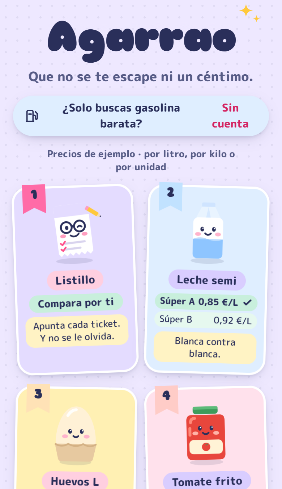
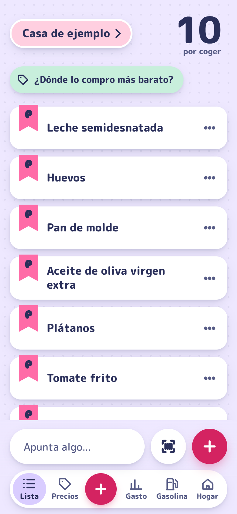
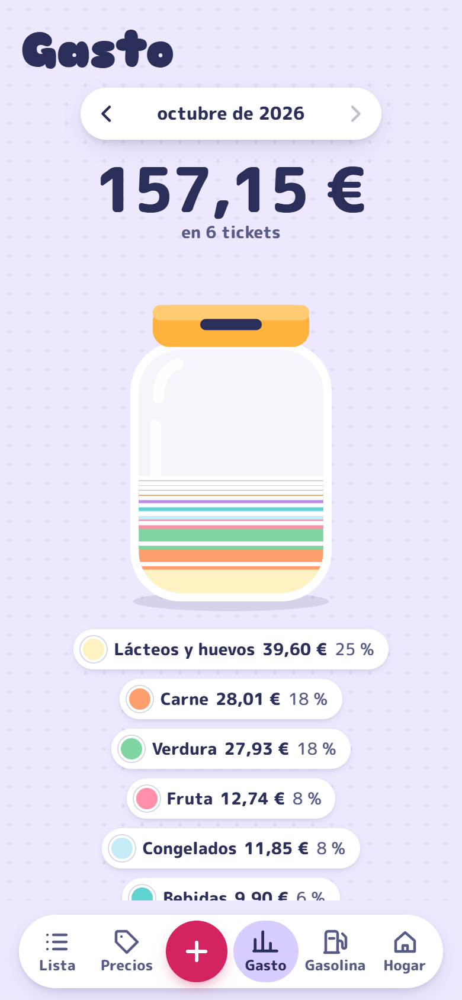
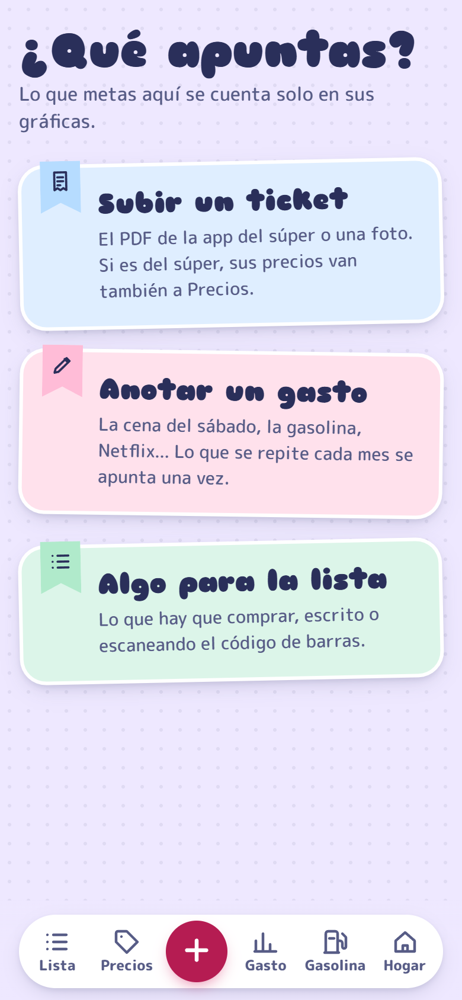
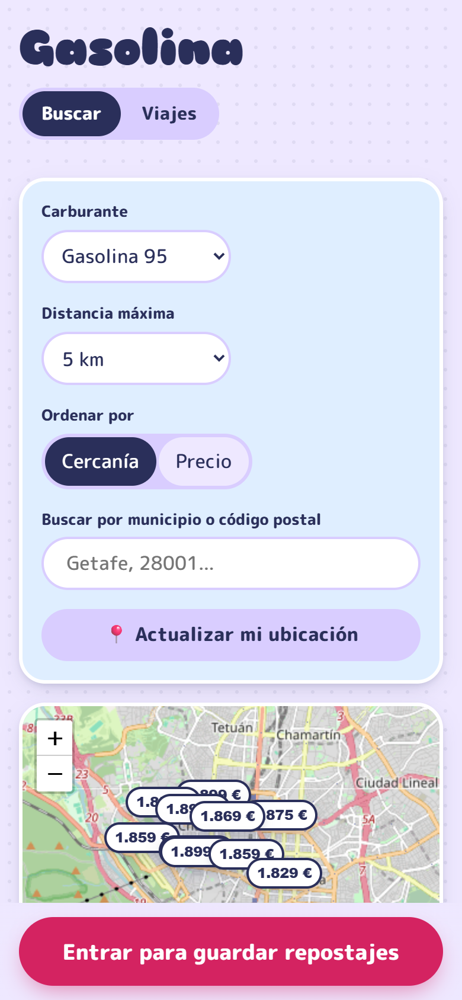

# Agarrao (antes Listillo y Apañaos)

> 🪞 **Espejo público.** El desarrollo se hace en un repositorio privado; este se actualiza periódicamente con una instantánea del código. La lectura de precios de las webs de los supermercados **no está incluida**: en público, los precios salen de los tickets y de [Open Prices](https://prices.openfoodfacts.org).

**Que no se te escape ni un céntimo.**

Desde la 1.0.0
Listillo es una sola app para el gasto de casa, con partes que cada persona enciende o
apaga (Lista, Precios, Gastos y Gasolina). Se llamó **Apañaos** en la 1.0.0 y **Agarrao**
desde la 1.1.0, que además trae dentro **Gasofa** (gasolineras y repostajes). Escanea el
código de barras, compara el precio **por unidad** (€/L, €/kg, €/ud) entre supermercados
españoles —también la **marca blanca equivalente**: la leche semi Hacendado contra la
Carrefour—, guarda los tickets, anota cualquier otro gasto (restaurantes, suscripciones,
gasolina…) y lo grafica por tipo. No reparte gastos entre los de casa: solo los apunta.

Todavía sin cambiar: el dominio (`listillo.pimon.dev`; irá a `agarrao.pimon.dev`), el
repo, el paquete `dev.pimon.listillo` y la base `listillo`. Ese cambio va aparte, con su
copia de seguridad. La mascota sigue llamándose Listillo.

Es una **PWA**: se instala desde el navegador en Android y en iPhone. No hay APK ni App
Store (ni la licencia de Apple).

## Capturas

En vivo en **[agarrao.pimon.dev](https://agarrao.pimon.dev)** (se entra con Google; la
gasolina, sin cuenta). Las capturas son de una instancia local con el hogar de ejemplo:
**los tickets y los gastos son inventados**.

<table>
  <tr>
    <th>Portada</th>
    <th>La lista</th>
    <th>Gasto del mes</th>
  </tr>
  <tr>
    <td></td>
    <td></td>
    <td></td>
  </tr>
  <tr>
    <th>¿Qué apuntas?</th>
    <th>Gasolina</th>
    <th></th>
  </tr>
  <tr>
    <td></td>
    <td></td>
    <td></td>
  </tr>
</table>

Se rehacen con la app en local (`ListilloLocal`, ver «Arrancar en local») y el hogar
«Casa de ejemplo», a 390×844 y escala 2.

Monorepo con dos proyectos independientes unidos por `docker-compose`:

- **`front/`**: Angular 21 (standalone, signals, zoneless) + Ionic 9 + service worker.
  Ver [`front/README.md`](front/README.md).
- **`back/`**: Spring Boot 3.4 + PostgreSQL + Flyway, sobre las libs `spring-*` 0.12.5.
  Ver [`back/README.md`](back/README.md).

## Estado

Hecho hasta ahora (fases 1–5):

- [x] Back con Flyway, tablas de las libs y `ddl-auto: validate`.
- [x] **Entrar con Google** (`ng-auth` + `spring-google`). Sin contraseñas.
- [x] **Versión de la app**: aviso opcional y bloqueo obligatorio.
- [x] Pantalla de bienvenida con el mundo visual «catálogo de personajes».
- [x] **Hogares y lista compartida**: crear o unirse con código/enlace, lista con cinta de
  quién apuntó cada cosa, tachar al carro, cantidades. Se refresca cada 10 s.
- [x] **Escáner + Open Food Facts**: la cámara lee el código (lector del navegador o zxing
  autoalojado en Safari), el back busca el producto en OFF y lo guarda; lo que OFF no
  conoce se nombra a mano y vale para todos. Escanear apunta en la lista.
- [x] **Tickets gratis**: ticket digital en PDF (probado con Mercadona, Lidl y Dia) (texto con PDFBox en el back) o foto
  leída en el móvil con Tesseract; un intérprete común saca tienda, fecha, total y líneas;
  cada línea se casa con un producto (lo aprendido por el hogar sale casado solo) y lo
  comprado se tacha de la lista.
- [x] **Genéricos y €/unidad** (pestaña Precios): catálogo de 95 genéricos de Listillo más
  los propios del hogar; cada producto de ticket se clasifica solo (categoría de Open Food
  Facts o nombre) y se corrige a mano; el tamaño sale del texto («6X1L»), de OFF o de la
  báscula. Al abrir un genérico, la marca blanca de cada súper se enfrenta «cara a cara».
- [x] **Gráficos de gasto** (pestaña Gasto): el mes como un tarro de hucha por pasillos,
  los seis últimos meses, por tienda y lo que más cuesta; los descuentos aparte.
- [x] Barra de pestañas abajo: Lista · Precios · Gasto · Hogar.
- [x] **Precios de las webs de los súper**, cada noche y solo con `PRECIOS_WEB=true`
  (apagado por defecto): Mercadona (~4.500 productos), Consum (~9.000),
  Ahorramás (~5.800), Eroski (~3.300), Caprabo (~2.400), Aldi (~2.100) y Lidl (~160: su web
  apenas publica comida). Dia, Carrefour, Alcampo y El Corte Inglés/Hipercor bloquean la
  lectura automática (Akamai, Cloudflare, AWS WAF) y no se burla esa protección: sus
  precios salen de los tickets. Family Cash no tiene tienda online (solo folletos) y la
  búsqueda de la web de Costco no devuelve productos: también van solo por tickets.
  Falta mirar BonPreu, Gadis, Masymas e HiperDino.
- [x] **Buscar cualquier cosa en los súper** (también el bazar: «fregona», «pilas aaa»):
  en Precios, lo más barato de cada cadena con foto y enlace a su ficha. Pasillo nuevo
  «Hogar y bazar» con sus genéricos (fregona, escoba, bayetas, pilas, bombillas…).
- [x] **¿Dónde lo compro?**: la lista repartida por el súper más barato de cada cosa, con lo
  que se ahorra frente a ir a uno solo.
- [x] **Ajustes** (pestaña Hogar): cambiar tu nombre y elegir qué supermercados ve y
  compara la casa (Precios, buscador y «¿Dónde lo compro?»). Si se marcan todos, se guarda
  «todos» y una cadena nueva sale sola.
- [x] Despliegue en https://listillo.pimon.dev (Coolify; Google con un client-id provisional).
- [x] **Open Prices**: cada noche, los precios de España del último año para
  las cadenas cuya web no se lee (Carrefour, Dia, Alcampo, BonPreu…). Cada precio dice
  «Open Prices» y su fecha; un ticket vuestro más reciente manda. Hay poco (~130 productos).
- [x] **Genéricos propios con precios de las webs**: el que os creéis («Presa ibérica»)
  recibe lo de las webs que se llama así (todas sus palabras, misma unidad). «No es esto»
  lo quita solo de vuestro genérico.
- [x] Catálogo ampliado a 157 genéricos (V18/V20): solomillo, chuletas, costillas, secreto,
  muslos, alitas, bacon, bacalao, mejillones, champiñones, croquetas…
- [x] Personaje propio para los 41 genéricos más comprados (30 dibujos nuevos); el resto
  lleva el de su pasillo.
- [x] **Un producto en cada súper**: en el buscador de Precios, tocar un producto («Nutella
  750 g» de Consum) enseña ese mismo producto en cada súper, del más barato al más caro por
  kilo o litro; si en uno no está del mismo tamaño, sale otro envase marcado «otro tamaño».
- [x] **Apuntar desde Precios**: «Apuntar en la lista» en el genérico abierto («Aguacates») y en
  el producto elegido del buscador (su nombre, hasta 80 letras). Si ya estaba pendiente, suma 1.
- [x] **1.0.0 · Apañaos**:
  - **Botón ＋** en medio de la barra (`/anadir`): subir un ticket, anotar un gasto o apuntar
    en la lista.
  - **Gastos anotados** (`/gastos/nuevo`, `/gastos/:id`): concepto, importe, fecha y tipo
    (Súper, Restaurantes, Gasolina, Suscripciones, Ocio, Casa, Otros). Se pueden rellenar
    leyendo el ticket (PDF o foto). Un ticket de «Otra tienda» se ofrece como gasto.
  - **Gastos fijos de cada mes** (Netflix…): se apuntan solos al llegar su día (hasta el 28).
  - **Gasto** suma tickets y anotados; la hucha va por tipo si hay algo más que súper (los
    pasillos pasan a su bloque); lista de lo anotado y de lo fijo.
  - **Qué usas** (Hogar): cada persona enciende o apaga Lista, Precios y Gastos; lo apagado
    sale de su barra.
  - **Guía «Cómo funciona»** (`/guia`): sale la primera vez en cada dispositivo y se abre
    siempre desde Hogar. **Novedades** (`/novedades`) sacadas de [`CHANGELOG.md`](CHANGELOG.md).
- [x] **1.1.0 · Agarrao y Gasolina**: nombre nuevo y Gasofa dentro:
  - Back `gasolina/` (de Gasofa): catálogo del Ministerio en memoria (`CatalogoEstaciones`,
    cada 30 min, `TlsDelMinisterio`), buscador público `/api/estaciones/**`, favoritas por
    persona, **vehículos y repostajes del hogar** (`/api/hogares/{h}/vehiculos|repostajes`).
    Los repostajes suman en Gasto como GASOLINA.
  - Front `/gasolina` (público) con Buscar, Favoritas, Repostajes y Coches; Leaflet y
    Chart.js; colores de Agarrao por `src/gasolina.scss`.
  - Datos de Gasofa pasados a la base de Agarrao (ver `infraestructura`).
- [x] gasofa.pimon.dev solo enseña «nos hemos mudado».
- [x] **1.2.0 · Viajes** (`/gasolina/viajes`, público): salida y llegada (municipio, CP o
  la ubicación del móvil), ruta en coche con OSRM y las gasolineras a menos de 1–10 km de la
  carretera, de la más barata a la más cara, con su kilómetro, el desvío y lo que se ahorra
  en 50 l frente a la media de la ruta. La flecha abre Google Maps con el viaje y la parada.
- [x] Dominio `agarrao.pimon.dev` (2026-10-13); `listillo.pimon.dev` redirige (nginx).
- [ ] Nombres internos (repo, paquete, base, Coolify).
- [ ] Subir los precios de vuestros tickets a Open Prices (con permiso de cada uno).
- [ ] Client-id de Google propio.

## Arrancar en local

```bash
cp .env.example .env          # rellena POSTGRES_PASSWORD, JWT_SECRET y GITHUB_TOKEN
docker compose up -d --build  # http://localhost:8080
```

Para desarrollar **sin Docker ni Postgres instalado**:

```bash
# back/ — Postgres embebido (datos en back/.local-db/) + la app en :8080
mvn spring-boot:test-run -Dspring-boot.run.main-class=dev.pimon.listillo.ListilloLocal
# front/ — http://localhost:4200, con proxy de /api al 8080
npm start
```

Con la base vacía, `ListilloLocal` crea el **usuario de prueba** `prueba@example.com` /
`Listillo1234!` (rol ADMIN). En **cada arranque** le rehace el hogar **«Casa de ejemplo»**
con siete meses de tickets inventados de cuatro cadenas y una lista pendiente (para ver
Precios, Gasto con la hucha llena y «¿Dónde lo compro?»), y enciende los precios de las
webs (importa Mercadona si tiene más de un día, ~2 min en segundo plano). En `npm start` la portada enseña «Entrar con el usuario de
prueba»; en producción ni el botón ni la clave existen. Borrar
`back/.local-db/` es empezar de cero.

Con un Postgres propio en `localhost:5432` (base, usuario y contraseña `listillo`) vale
`mvn spring-boot:run`.

## La versión de la app

- La versión vive **solo** en `front/package.json`. `npm start/build/test` la copian a
  `src/app/core/version-app.ts` (`tools/escribir-version.mjs`).
- Al arrancar, la app pregunta `GET /api/app/version?actual=x.y.z` y el back responde
  `AL_DIA`, `OPCIONAL` u `OBLIGATORIA`.
- La versión publicada (`ultima`, `minima`, `notas`) está en la tabla `version_app` y se
  cambia con `PUT /api/admin/app/version` (ROLE_ADMIN), sin redesplegar.

**Al publicar una versión:** sube `version` en `front/package.json` y `back/pom.xml`,
**escribe sus novedades arriba del todo en [`CHANGELOG.md`](CHANGELOG.md)** (si la primera
del CHANGELOG no es la de `package.json`, `npm start/build/test` fallan a propósito),
despliega y después sube `ultima` (y `minima` solo si la vieja ya no funciona con el back
nuevo). La app enseña el CHANGELOG en Hogar → Novedades: el script lo convierte en
`src/app/core/novedades.ts`, que **se versiona** porque la imagen Docker del front solo ve
la carpeta `front/`.

